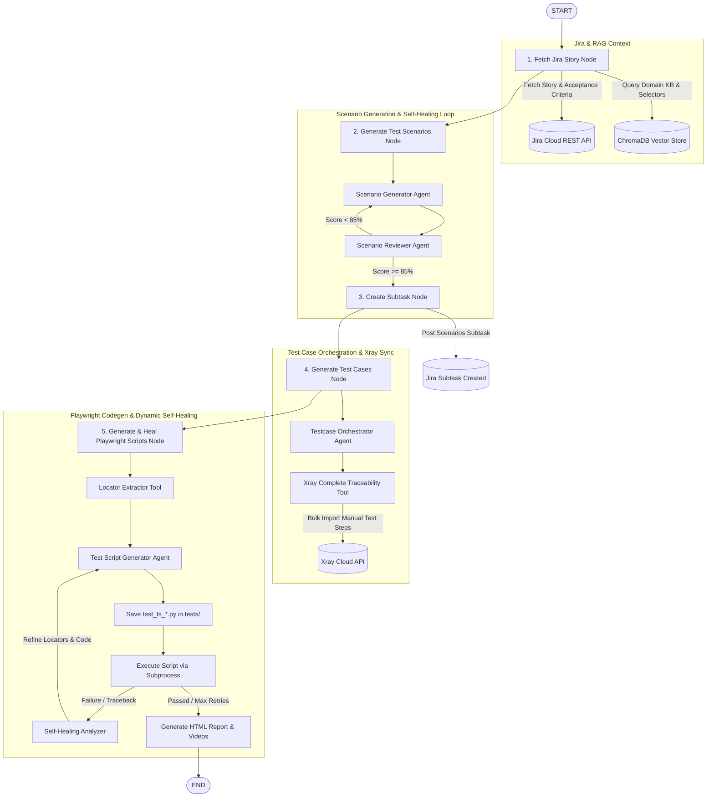

# Autonomous AI-Powered Quality Engineering (QE) Pipeline

An enterprise-grade, end-to-end Quality Engineering (QE) automation framework orchestrated with **LangGraph**, **LangChain**, and **Google Gemini LLM**. 

The system autonomously fetches Jira User Stories, performs domain-aware **RAG (Retrieval-Augmented Generation)** over application documentation, designs test scenarios through a **multi-agent self-healing loop**, synchronizes subtasks and manual test cases into **Jira & Xray**, generates modular **Playwright (Python)** test scripts, and automatically executes, self-heals, records video sessions, and generates rich HTML execution reports.

---

## 🌟 Key Features

* **LangGraph State Orchestration**: Deterministic workflow control using a shared typed memory state (`GraphState`) passing context seamlessly across specialized pipeline nodes.
* **Bi-directional Jira Cloud Integration**: Programmatically extracts Jira story details (acceptance criteria, description, issue keys) and writes back finalized test scenarios as structured Jira subtasks.
* **Atlassian Xray Test Management**: Directly imports structured test cases with manual steps (Action, Data, Expected Result) into Xray via bulk REST APIs and links them to the parent Jira story with full traceability (`Tests` / `is tested by`).
* **Domain-Aware RAG Engine**: ChromaDB vector store embedded with `sentence-transformers/all-MiniLM-L6-v2`. Semantic retrieval injects live application knowledge (e.g., OrangeHRM workflows, UI page models, and Playwright locators) into agent prompts.
* **Dual-Agent Self-Healing Review Loops**:
  * **Scenario Generation**: A Generator agent crafts scenarios, while a Reviewer agent critiques against Acceptance Criteria. If confidence is `< 85%`, it triggers targeted revision rounds.
  * **Test Case Generation**: Formulates comprehensive test cases, validating against coverage, boundary conditions, and testability.
* **Autonomous Playwright Test Script Generation**: Formulates standalone, modular test scripts placed directly in `tests/test_ts_*.py` adhering to Pytest conventions.
* **Dynamic Code Execution & Runtime Self-Healing**: Automatically executes generated test scripts using subprocesses. If an assertion or selector fails, the agent analyzes the runtime traceback, re-inspects locators, and iteratively heals the script up to a configurable retry limit.
* **Video Recording & Visual Reporting**: Automatically captures WebM/MP4 execution videos of browser sessions and compiles a comprehensive dark-themed Playwright HTML execution report with pass/fail badges, retry metrics, and embedded video players.

---

## 🏗️ System Architecture & Workflow



---

## 🧩 Pipeline Nodes & Agent Matrix

| Pipeline Node | Responsible Agent / Tool | Purpose & Outputs |
| :--- | :--- | :--- |
| **`fetch_jira_story`** | `fetch_jira_details_agent`<br>`jira_read_tool` | Reads requirements, summary, description, and issue key from Jira Cloud. Populates `GraphState.jira_story`. |
| **`generate_test_scenarios`** | `scenario_orchestrator_agent`<br>`scenario_self_healing_tool` | Generates edge cases, happy paths, and negative scenarios. Employs dual-agent review loop until quality score ≥ 85%. |
| **`create_subtask`** | `jira_create_subtask_tool` | Synchronizes formatted scenarios back to Jira as a traceable subtask. |
| **`generate_test_cases`** | `testcases_orchestrator_agent`<br>`xray_jira_tool` | Decomposes scenarios into detailed test cases with manual steps. Synchronizes tests directly to Xray Cloud with story linkage. |
| **`generate_and_heal_test_scripts`** | `testscript_generator_agent`<br>`script_self_healing_tool`<br>`locator_extractor_tool` | Extracts target web locators, generates Pytest Playwright scripts in `tests/`, executes them, heals failures up to `SCRIPT_MAX_RETRIES`, records video, and produces `outputs/reports/playwright_report.html`. |

---

## 📁 Repository Structure

```text
├── docs/
│   ├── architecture.md           # LangGraph StateGraph design documentation
│   └── learnings_tracker.md      # Engineering concepts and milestones tracker
├── main.py                       # Pipeline runner entrypoint
├── outputs/
│   ├── final_scenarios.json      # Structured test scenarios output
│   ├── final_testcases.json      # Final step-by-step test cases
│   └── reports/
│       ├── playwright_report.html # Dark-mode interactive HTML execution report
│       └── videos/               # Playwright browser session recording videos (.webm)
├── requirements.txt              # Core Python dependencies
├── src/
│   ├── graph.py                  # LangGraph compiled state graph definition
│   ├── agents/                   # ReAct & Orchestrator LLM agents
│   │   ├── fetch_jira_details_agent.py
│   │   ├── scenario_generator_agent.py
│   │   ├── scenario_reviewer_agent.py
│   │   ├── scenario_orchestrator_agent.py
│   │   ├── testcases_generator_agent.py
│   │   ├── testcase_reviewer_agent.py
│   │   ├── testcases_orchestrator_agent.py
│   │   └── testscript_generator_agent.py
│   ├── core/
│   │   ├── ingest_kb.py          # Vector ingestion script for ChromaDB
│   │   ├── llm.py                # Gemini LLM initialization & configurations
│   │   ├── prompts.py            # System prompts & guidelines
│   │   └── state.py              # LangGraph GraphState TypedDict
│   ├── knowledge_base/           # Domain knowledge markdown/text files for RAG
│   │   ├── orangehrm-dashboard-kb.txt
│   │   └── orangehrm-login-dashboard-playwright-locators.txt
│   ├── models/
│   │   └── schemas.py            # Pydantic structured output models
│   ├── nodes/                    # LangGraph execution nodes
│   │   ├── jira_node.py          # Jira story fetch and subtask creation
│   │   ├── scenario_node.py      # Test scenario generation node
│   │   ├── testcases_node.py     # Test case generation and Xray sync node
│   │   └── testScriptGen_node.py # Playwright codegen, execution & healing node
│   └── tools/                    # Reusable tools & API clients
│       ├── locator_extractor_tool.py    # Live application locator extraction
│       ├── rag_tools.py                 # ChromaDB semantic search tools
│       ├── scenario_self_healing_tool.py# Dual-agent scenario healing loop
│       ├── testcases_selfHealing_tool.py# Test case generation review tool
│       ├── script_self_healing_tool.py  # Playwright execution & self-healing engine
│       ├── tools.py                     # Jira REST API tools
│       └── xray_jira_tool.py            # Atlassian Xray Cloud bulk sync tool
├── tests/                        # Individual generated Playwright test scripts
│   ├── conftest.py               # Pytest configuration & video capture fixture
│   └── test_ts_*.py              # Modular test scripts per testcase
└── vector_store/                 # ChromaDB persistent database files
```

---

## ⚙️ Prerequisites & Setup

### 1. Python Environment
Python 3.12+ is recommended. Using `uv` enables ultra-fast virtual environment and dependency setup:

```bash
# Create and activate virtual environment
uv venv
.venv\Scripts\activate       # On Windows
# source .venv/bin/activate  # On macOS/Linux

# Install dependencies
uv pip install -r requirements.txt

# Install Playwright browser binaries
playwright install chromium
```

*(Alternatively, use standard `python -m venv .venv` and `pip install -r requirements.txt`)*.

---

### 2. Environment Configuration (`.env`)

Create a `.env` file in the root directory (or copy from `.env.example`):

```env
# ==========================================
# Google Gemini LLM Configuration
# ==========================================
GEMINI_API_KEY=your_gemini_api_key_here
GEMINI_MODEL=gemini-3.1-flash-lite   # or gemini-1.5-flash / gemini-2.5-flash

# ==========================================
# Jira Integration Configuration
# ==========================================
JIRA_DOMAIN=https://your-domain.atlassian.net
JIRA_USERNAME=your_email@example.com
JIRA_API_KEY=your_jira_api_token_here

# ==========================================
# Xray Enterprise Integration (Optional)
# ==========================================
XRAY_CLIENT_ID=your_xray_client_id_here
XRAY_CLIENT_SECRET=your_xray_client_secret_here

# ==========================================
# Test Script Self-Healing Settings
# ==========================================
SCRIPT_MAX_RETRIES=5

# ==========================================
# LangSmith Tracing (Optional)
# ==========================================
LANGCHAIN_TRACING_V2=true
LANGCHAIN_API_KEY=your_langsmith_api_key_here
LANGCHAIN_PROJECT=QE-Automation-Graph
```

---

### 3. Ingest Domain Knowledge into Vector Database

Before the first pipeline run, index your documentation and Playwright locators into ChromaDB:

```bash
python -m src.core.ingest_kb
```

This ingests all documents from `src/knowledge_base/` into `vector_store/` with sentence embeddings.

---

## 🚀 Execution

### 1. Run the Full End-to-End Pipeline
Executes the entire LangGraph workflow from Jira extraction to Playwright test generation and self-healing:

```bash
python main.py
```

#### What happens during execution:
1. **Jira Fetch**: Downloads the targeted user story, issue key, description, and acceptance criteria.
2. **Scenario Generation**: RAG searches ChromaDB for domain context; Generator & Reviewer agents iterate until achieving a score ≥ 85%.
3. **Jira Subtask**: Posts the validated scenarios to the Jira story.
4. **Test Cases & Xray**: Generates granular manual test steps and synchronizes them to Xray Cloud.
5. **Playwright Script Generation**: Tests are generated into individual scripts under `tests/test_ts_XX_*.py`.
6. **Execution & Self-Healing**: Scripts execute headlessly; failures are analyzed, repaired, and re-tested up to 5 rounds.
7. **Reports & Video**: Execution videos are saved to `outputs/reports/videos/` and an interactive report is generated at `outputs/reports/playwright_report.html`.

---

### 2. Run the Generated Playwright Scripts Manually
You can run any generated script directly with Python or Pytest:

```bash
# Run a specific generated test script directly
python tests/test_ts_01_verify_login_page_elements_are_displayed.py

# Run all generated test scripts via Pytest with HTML report
pytest tests/ -v --html=outputs/reports/pytest_report.html --self-contained-html
```

---

## 📊 Pipeline Outputs & Deliverables

| Output Asset | Location | Description |
| :--- | :--- | :--- |
| **Scenarios JSON** | `outputs/final_scenarios.json` | Complete JSON output of the LangGraph state including scenarios and review scores. |
| **Test Cases JSON** | `outputs/final_testcases.json` | Detailed test case breakdown with preconditions, steps, test data, and expected results. |
| **Playwright Test Scripts** | `tests/test_ts_*.py` | Standalone, runnable Playwright Python test files with helper routines and assertions. |
| **Interactive HTML Report** | `outputs/reports/playwright_report.html` | Dark-themed dashboard featuring pass/fail statistics, healed count, script details, and embedded videos. |
| **Execution Videos** | `outputs/reports/videos/*.webm` | Browser execution video recordings of each test run. |
| **Jira Subtask & Xray Tests** | Cloud Jira Instance | Traceable Jira subtasks and Xray native Test issues linked directly to the parent story. |

---

## 🛠️ Tech Stack

* **Frameworks & Orchestration**: [LangGraph](https://github.com/langchain-ai/langgraph), [LangChain](https://github.com/langchain-ai/langchain)
* **LLM Engine**: [Google Gemini](https://ai.google.dev/) (`gemini-3.1-flash-lite`, `gemini-1.5-flash`)
* **Vector Store & Embeddings**: [ChromaDB](https://www.trychroma.com/), [HuggingFace Sentence Transformers](https://huggingface.co/sentence-transformers/all-MiniLM-L6-v2)
* **Test Automation**: [Playwright Python](https://playwright.dev/python/), [pytest](https://pytest.org/)
* **Integrations**: Atlassian Jira Cloud REST API, Xray Cloud GraphQL/REST API
* **Data Validation**: [Pydantic v2](https://docs.pydantic.dev/)
